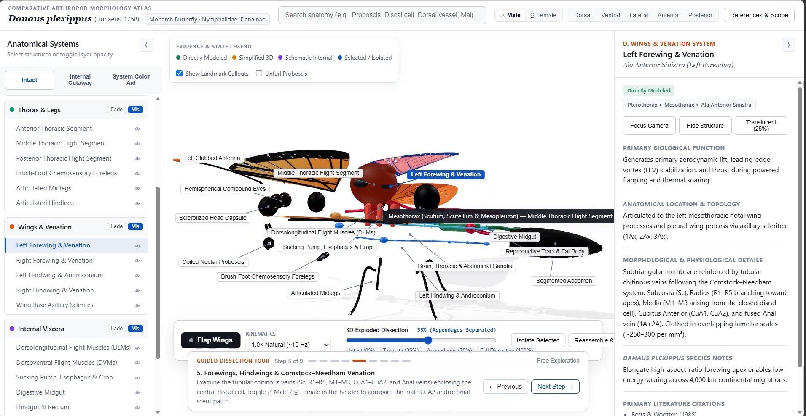

# Butterfly Anatomy Atlas

An interactive 3D atlas for exploring butterfly anatomy.

This project started as an attempt to build a 3D butterfly model that people could explore directly in a browser. Instead of using a static image, the idea was to make it possible to rotate the specimen, inspect different anatomical structures, and use labels to understand what is being shown.

The project is still open to improvements, especially in anatomical detail, visualization, and the way information is presented.

## Preview

<p align="center">
  <a href="show.png">
    
  </a>
</p>

## Features

- Interactive 3D butterfly model
- Labels for anatomical structures
- Controls for rotating and zooming the model
- A layered interface for inspecting different structures
- Responsive layout for different screen sizes

The available features depend on the current implementation. The project can be extended with additional anatomical labels, annotations, and visualization layers.

## Running locally

If the project uses plain HTML, CSS, and JavaScript, you can run it with Python's built-in HTTP server.

```bash
python -m http.server 8000
```

Then open [http://localhost:8000](http://localhost:8000) in your browser.

If the project uses Vite or another Node.js development setup, install the dependencies and use the scripts defined in `package.json`.

```bash
npm install
npm run dev
```

## Project structure

The exact structure depends on the files included in the repository. A typical layout might look like this:

```text
.
├── index.html
├── src/
├── styles/
├── assets/
│   └── models/
├── show.png
├── README.md
└── LICENSE
```

## Possible improvements

Some ideas for future development:

- Add more detailed anatomical labels
- Include short explanations for individual structures
- Allow users to switch between different visualization layers
- Add guided tours for students learning butterfly anatomy
- Support additional languages

These are potential extensions rather than a list of features that are necessarily implemented already.

## License

See the `LICENSE` file for licensing information.

## Author

**Mehdi Sadeghi**  
GitHub: [@Metisa811](https://github.com/Metisa811)
